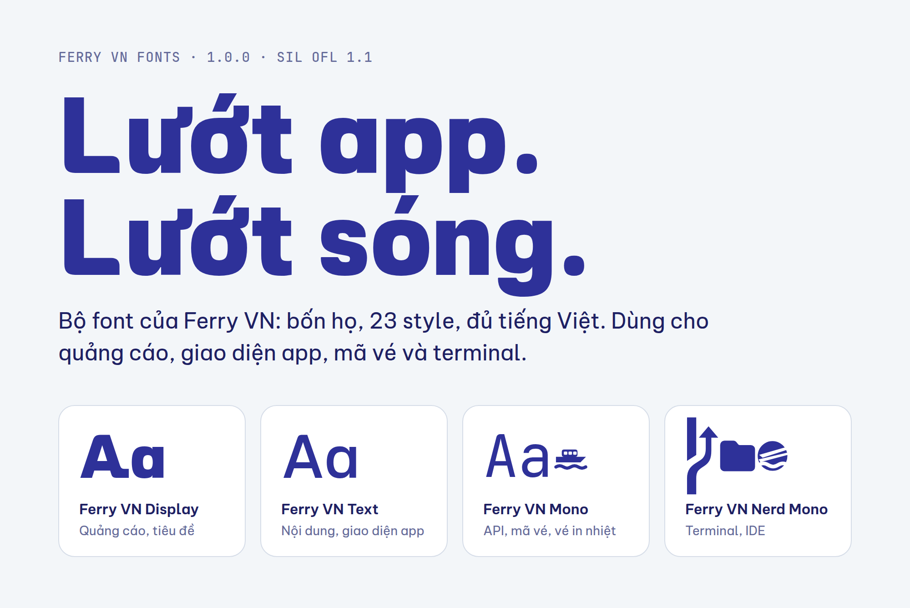
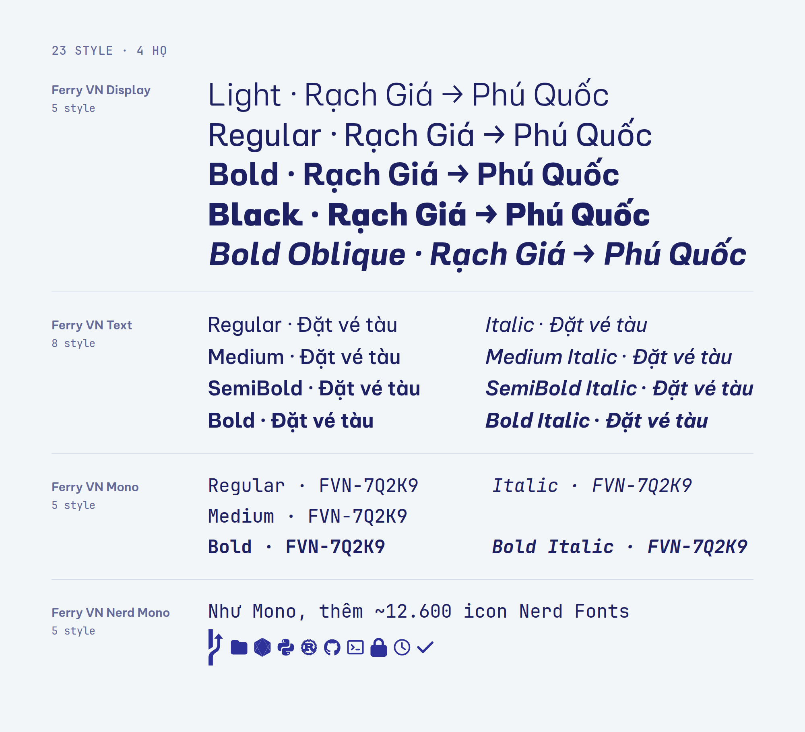
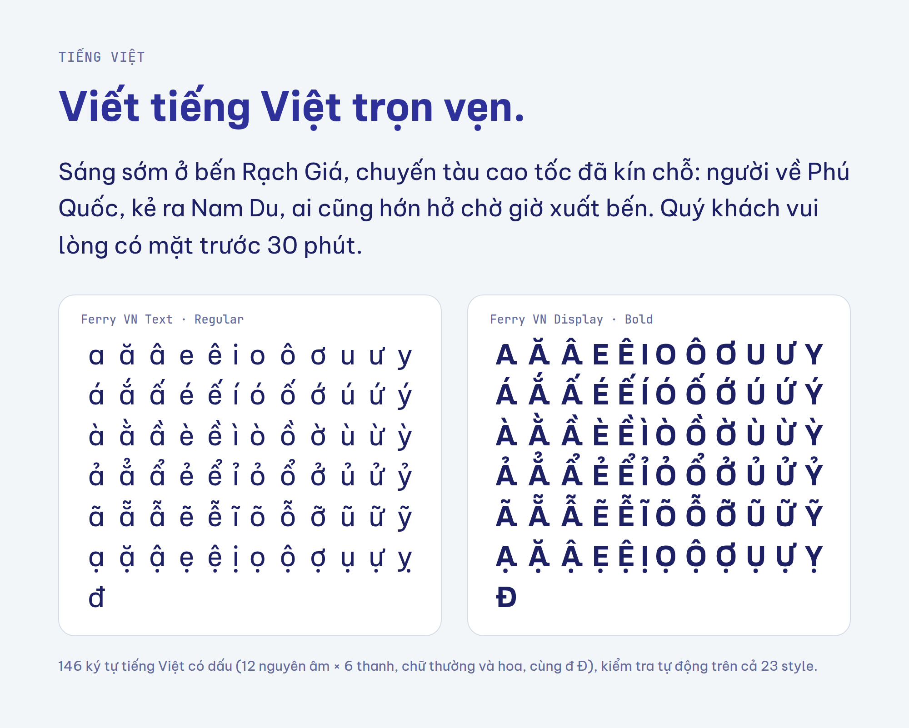
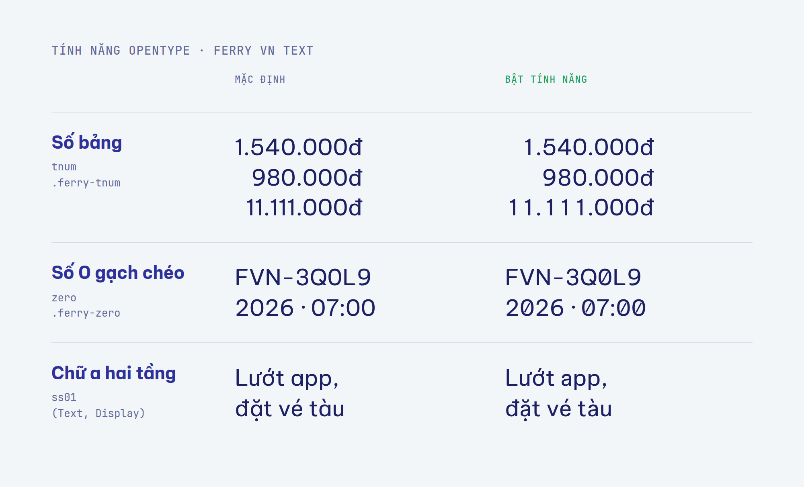
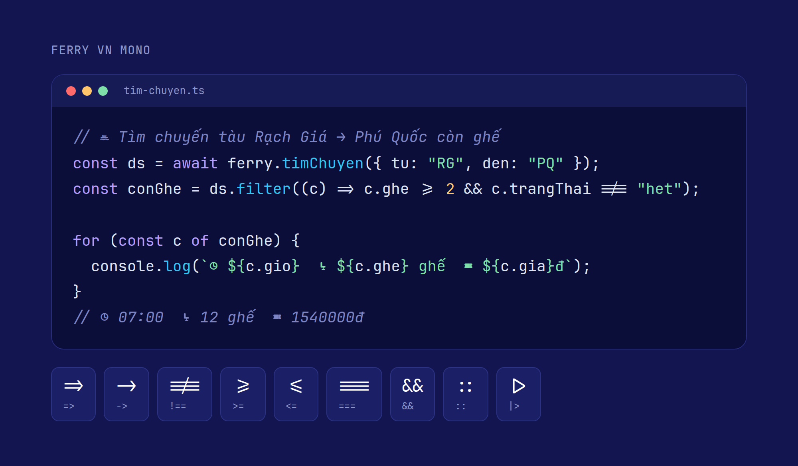
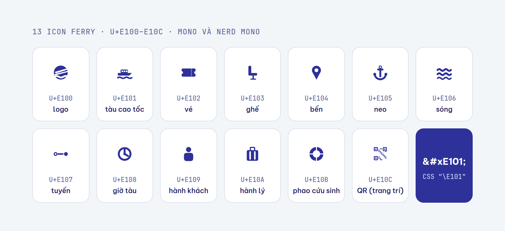
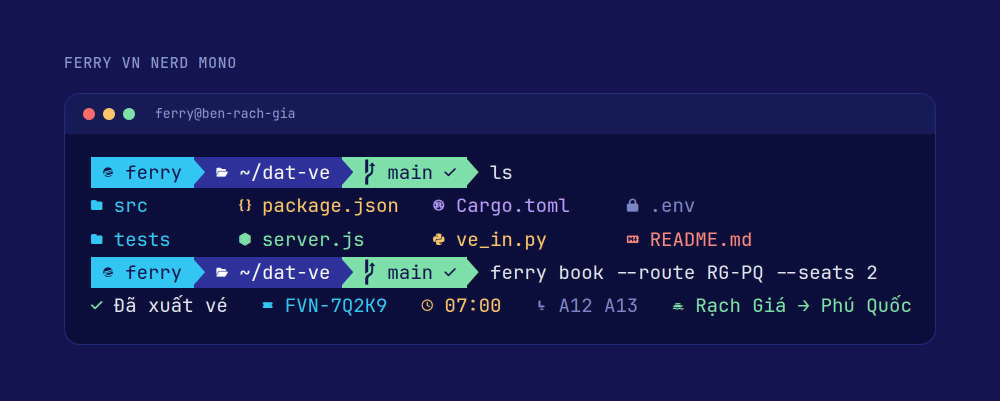

<a href="https://fonts.ferry.vn/1.0.0/">
  <picture>
    <source media="(prefers-color-scheme: dark)" srcset="docs/images/banner-dark.png">
    
  </picture>
</a>

# Ferry VN Fonts

Bộ font chính thức của [Ferry VN](https://ferryvn.com). Gồm 4 họ, 23 style, đủ tiếng Việt, phát hành miễn phí theo SIL Open Font License 1.1.

[](https://github.com/ferry-vn/ferry-fonts/releases/latest)
[](OFL.txt)
[](https://fonts.ferry.vn/1.0.0/)

**[⬇ Tải font (Releases)](https://github.com/ferry-vn/ferry-fonts/releases/latest)** · [Trang demo](https://fonts.ferry.vn/1.0.0/) · [Dùng trên web](#dùng-trên-web) · [Cài trên máy](#cài-trên-máy) · [CHANGELOG](CHANGELOG.md)

### Hỏi nhanh

- **Tải ở đâu?** Ở trang [Releases](https://github.com/ferry-vn/ferry-fonts/releases/latest), file `FerryVN-Fonts-<phiên bản>.zip`.
- **Dùng trên web thế nào?** Nhúng một dòng `<link>` từ CDN `fonts.ferry.vn` ([xem bên dưới](#dùng-trên-web)), không cần tự host.
- **Terminal nên dùng bản nào?** Ferry VN Nerd Mono. Trên web, app hay vé in thì dùng Ferry VN Mono vì nhẹ hơn khoảng 10 lần.
- **Dùng cho sản phẩm thương mại được không?** Được. Giấy phép OFL cho phép dùng, nhúng, sửa và phân phối lại; chỉ cấm bán riêng file font. Xem thêm phần [Giấy phép](#giấy-phép).
- **Gặp lỗi hiển thị?** Mở [issue](https://github.com/ferry-vn/ferry-fonts/issues), ghi kèm hệ điều hành, ứng dụng, cỡ chữ và ảnh chụp.

## Bốn họ font

| Họ | Dùng cho | Style | Dựng trên |
|---|---|---|---|
| **Ferry VN Display** | Quảng cáo, tiêu đề | Light, Regular, Bold, Black, Bold Oblique | [Be Vietnam Pro](https://github.com/bettergui/BeVietnamPro) |
| **Ferry VN Text** | Nội dung, giao diện app | Regular, Medium, SemiBold, Bold, mỗi độ đậm có Italic | [Be Vietnam Pro](https://github.com/bettergui/BeVietnamPro) |
| **Ferry VN Mono** | API, mã vé, vé in nhiệt, code | Regular, Medium, Bold, Italic, Bold Italic | [JetBrains Mono](https://github.com/JetBrains/JetBrainsMono) 2.304 |
| **Ferry VN Nerd Mono** | Terminal, IDE | Như Mono | JetBrains Mono + [Nerd Fonts](https://github.com/ryanoasis/nerd-fonts) 3.5.1 |



## Tiếng Việt

Mọi style đều có đủ 146 ký tự tiếng Việt có dấu, gồm 12 nguyên âm với 6 thanh ở cả chữ thường và chữ hoa, cùng đ và Đ. Script kiểm tra phát hành rà lại bộ ký tự này trên từng file font.



## Tính năng

### Ferry VN Text: số bảng, số 0 gạch chéo, chữ a hai tầng



| Tính năng | Tác dụng | CSS | Class có sẵn |
|---|---|---|---|
| `tnum` | Mọi chữ số rộng bằng nhau, cột giá vé và giờ tàu thẳng hàng | `font-variant-numeric: tabular-nums;` | `.ferry-tnum` |
| `zero` | Số 0 có gạch chéo để không nhầm với chữ O trong mã đặt chỗ | `font-feature-settings: "zero" 1;` | `.ferry-zero` |
| `ss01` | Đổi chữ a một tầng (mặc định) sang a hai tầng. Có ở cả Display và Text | `font-feature-settings: "ss01" 1;` | |

Display không có `tnum` và `zero`. Khi bật cùng lúc nhiều tính năng, phải liệt kê chung trong một khai báo, ví dụ `font-feature-settings: "zero" 1, "ss01" 1;`.

### Ferry VN Mono: ligature lập trình và icon Ferry



- Mọi glyph rộng đúng 600 đơn vị, nên mã vé và bảng in nhiệt luôn thẳng cột.
- Ligature lập trình (`=>`, `!==`, `>=`, ...) nằm trong `calt`, kế thừa từ JetBrains Mono. Tắt bằng `font-variant-ligatures: none;` trên web, hoặc `"editor.fontLigatures": false` trong VS Code.
- Giữ nguyên các biến thể ký tự của JetBrains Mono: `cv01`–`cv12`, `cv14`–`cv20`, `ss01`, `ss02`, `ss19`, `ss20` và `zero`. Xem [cách bật trong JetBrains Mono](https://github.com/JetBrains/JetBrainsMono/wiki/OpenType-features).
- Có ký hiệu Powerline (`U+E0A0–E0A2`, `U+E0B0–E0B3`) và ký tự kẻ khung.

### Icon Ferry

Mono và Nerd Mono có 13 icon riêng ở vùng Private Use `U+E100–U+E10C`:



| Mã | Icon | Mã | Icon | Mã | Icon |
|---|---|---|---|---|---|
| `U+E100` | logo | `U+E105` | neo | `U+E10A` | hành lý |
| `U+E101` | tàu cao tốc | `U+E106` | sóng | `U+E10B` | phao cứu sinh |
| `U+E102` | vé | `U+E107` | tuyến | `U+E10C` | QR (chỉ để trang trí) |
| `U+E103` | ghế | `U+E108` | giờ tàu | | |
| `U+E104` | bến | `U+E109` | hành khách | | |

```html
<span style="font-family: 'Ferry VN Mono'">&#xE101; RG → PQ</span>
```
```css
.icon-tau::before { font-family: "Ferry VN Mono"; content: "\E101"; }
```

Icon chỉ hiện khi phần tử dùng Ferry VN Mono hoặc Nerd Mono. Với font khác, các mã này hiện ô trống.

### Ferry VN Nerd Mono: cho terminal



Nerd Mono giống hệt Mono, chỉ thêm toàn bộ icon Nerd Fonts 3.5.1 (khoảng 12.600 glyph). Các prompt như Starship, Oh My Posh, Powerlevel10k và các plugin file-icon của Neovim, lsd, eza cần bộ icon này để hiển thị đúng.

## Dùng trên web

Nhúng một dòng là có Display, Text và Mono:

```html
<link rel="preconnect" href="https://fonts.ferry.vn" crossorigin>
<link rel="stylesheet" href="https://fonts.ferry.vn/1.0.0/css/ferry-vn-fonts.css">
```

Hoặc dùng `@import` trong CSS:

```css
@import url("https://fonts.ferry.vn/1.0.0/css/ferry-vn-fonts.css");
```

```css
h1, h2 { font-family: "Ferry VN Display", system-ui, sans-serif; }
body   { font-family: "Ferry VN Text", system-ui, sans-serif; }
code   { font-family: "Ferry VN Mono", ui-monospace, monospace; }
```

Để chữ hiện ngay ở màn hình đầu, có thể nạp trước font của tiêu đề:

```html
<link rel="preload" href="https://fonts.ferry.vn/1.0.0/fonts/ferry-vn-display-bold.woff2" as="font" type="font/woff2" crossorigin>
```

| File CSS | Nạp những họ nào | Dung lượng WOFF2 mỗi style |
|---|---|---|
| `css/ferry-vn-fonts.css` | Display, Text, Mono | khoảng 40 KB (Display, Text), khoảng 64 KB (Mono) |
| `css/ferry-vn-display.css` | Display | khoảng 40 KB |
| `css/ferry-vn-text.css` | Text | khoảng 40 KB |
| `css/ferry-vn-mono.css` | Mono | khoảng 64 KB |
| `css/ferry-vn-nerd-mono.css` | Nerd Mono, **không** nằm trong CSS chung | khoảng 1 MB |

Trình duyệt chỉ tải style mà trang thật sự dùng. Font web đã được cắt gọn, chỉ giữ Latin, Latin mở rộng, tiếng Việt, dấu câu, ký hiệu tiền tệ (có `₫`) và mũi tên. Mono giữ thêm ký tự kẻ khung, Powerline và icon Ferry. Nếu cần ký tự ngoài bộ này, dùng file TTF trong gói tải về. Nerd Mono không bị cắt gọn, nên chỉ nạp khi thật sự cần, ví dụ terminal chạy trên web.

### Đường dẫn cố định theo phiên bản

Mỗi phiên bản có đường dẫn riêng (`/1.0.0/`, `/1.0.1/`, `/1.1.0/`, ...) và nội dung **không bao giờ đổi** sau khi công bố. CDN trả về `Cache-Control: public, max-age=31536000, immutable` và `Access-Control-Allow-Origin: *`. Muốn nhận bản sửa lỗi thì đổi số phiên bản trong URL.

### Tự host

Thư mục `site/1.0.0/` trong gói tải về có thể chép nguyên lên server của bạn. CSS dùng đường dẫn tương đối `../fonts/`, nên không cần sửa gì.

## Cài trên máy

Tải `FerryVN-Fonts-<phiên bản>.zip` ở [Releases](https://github.com/ferry-vn/ferry-fonts/releases/latest) rồi giải nén. File TTF nằm trong `desktop/`, chia theo họ:

| Thư mục | Dành cho | Dung lượng mỗi style |
|---|---|---|
| `desktop/Display/`, `desktop/Text/` | Designer, Figma, Office | khoảng 140 KB |
| `desktop/Mono/` | IDE, tài liệu kỹ thuật | khoảng 270 KB |
| `desktop/NerdMono/` | Terminal | khoảng 2,5 MB |

- **macOS:** chọn các file `.ttf`, nhấp đúp rồi bấm **Install Font**, hoặc kéo vào Font Book.
- **Windows:** chọn các file `.ttf`, nhấp chuột phải rồi chọn **Install for all users**.
- **Linux:**
  ```bash
  mkdir -p ~/.local/share/fonts/FerryVN
  cp desktop/*/*.ttf ~/.local/share/fonts/FerryVN/
  fc-cache -f
  ```

> [!NOTE]
> Trước khi nâng cấp, nên gỡ bản cũ rồi khởi động lại các ứng dụng đang dùng font. Hệ điều hành thường giữ cache font cũ.

> [!TIP]
> Trên Windows và một số ứng dụng cũ, các độ đậm ngoài Regular/Bold hiện thành họ riêng: **Ferry VN Display Light**, **Ferry VN Display Black**, **Ferry VN Text Medium**, **Ferry VN Text SemiBold**, **Ferry VN Mono Medium**, **Ferry VN Nerd Mono Medium**. Ứng dụng hiểu nhóm họ font (Figma, Adobe, macOS) sẽ gộp chúng vào một họ.

### Cấu hình editor và terminal

**VS Code** (`settings.json`):

```json
{
  "editor.fontFamily": "'Ferry VN Mono', monospace",
  "editor.fontLigatures": true,
  "terminal.integrated.fontFamily": "'Ferry VN Nerd Mono'"
}
```

**JetBrains IDE:** vào `Settings` → `Editor` → `Font`, chọn `Ferry VN Mono` và đánh dấu **Enable ligatures**.

**Windows Terminal** (`settings.json`):

```json
{ "profiles": { "defaults": { "font": { "face": "Ferry VN Nerd Mono" } } } }
```

**Các terminal khác:**

| Terminal | Cấu hình |
|---|---|
| iTerm2 | `Settings` → `Profiles` → `Text` → `Font`: Ferry VN Nerd Mono |
| Ghostty | `font-family = Ferry VN Nerd Mono` |
| Kitty | `font_family Ferry VN Nerd Mono` |
| WezTerm | `config.font = wezterm.font("Ferry VN Nerd Mono")` |
| Alacritty | `[font]` → `normal = { family = "Ferry VN Nerd Mono" }` |

## Specimen

Ảnh specimen độ phân giải cao: [Display](specimens/FerryVN-Display-1.0.png) · [Text](specimens/FerryVN-Text-1.0.png) · [Mono](specimens/FerryVN-Mono-1.0.png) · [So sánh độ rộng với 29 font sans phổ biến](specimens/FerryVN-width-benchmark.png). Trang demo trực tiếp: <https://fonts.ferry.vn/1.0.0/>.

## Hạn chế đã biết (1.0.0)

- Nghiêng của Display Bold Oblique là nghiêng cơ học 8,2°, chưa chỉnh quang học.
- Kerning của các chân lướt (A, R, K, k) do thuật toán tính, chưa duyệt tay.
- Các glyph đã chỉnh trong Mono và icon Ferry chưa có hinting. Icon chưa được tinh chỉnh cho cỡ dưới 16px. Icon QR chỉ để trang trí, không quét được.

Chi tiết từng phiên bản ở [CHANGELOG.md](CHANGELOG.md).

## Cấu trúc repo

```
site/                 Gốc CDN fonts.ferry.vn, deploy nguyên trạng
  _headers            CORS cho mọi file, cache 1 năm cho thư mục phiên bản
  _redirects          / → /1.0.0/ (trang demo)
  1.0.0/              index.html (demo), css/, fonts/ (WOFF2)
desktop/              23 file TTF: Display, Text, Mono, NerdMono
specimens/            Ảnh specimen và phân tích độ rộng
docs/images/          Ảnh minh hoạ cho README
source/               Script dựng font, đo benchmark, kiểm tra phát hành
LICENSES/             OFL của từng font gốc, NOTICE, giấy phép Nerd Fonts
wrangler.jsonc        Cấu hình Cloudflare Worker phục vụ site/
OFL.txt               SIL Open Font License 1.1
```

<details>
<summary><b>Dành cho người bảo trì: kiểm tra và phát hành phiên bản mới</b></summary>

### Kiểm tra font

```bash
pip install fonttools
python source/qa_release.py desktop
```

Script kiểm tra trên từng file TTF:
- Đủ 146 ký tự tiếng Việt.
- Tên PostScript không trùng.
- `fsType 0`, tức cho phép cài đặt và nhúng.
- Version là 1.000.
- Mono rộng đúng 600 và đủ 13 icon Ferry.
- Lưu lại file không lỗi.

Các script dựng font khác trong `source/` là bản đã dùng để dựng 1.0.0, chỉ lưu để tham khảo. Chúng cần font gốc (Be Vietnam Pro, JetBrains Mono, bản vá Nerd Fonts) không có trong repo, và phải sửa đường dẫn đầu vào trước khi chạy lại.

### Phát hành

1. Thêm thư mục `site/<phiên bản mới>/` và **giữ nguyên mọi thư mục phiên bản cũ**. Mỗi lần deploy, Cloudflare thay toàn bộ asset bằng nội dung `site/` hiện tại, nên thiếu thư mục cũ là đường dẫn cũ bị mất.
2. Thêm khối `Cache-Control` cho thư mục mới trong `site/_headers`. Nếu muốn trang demo mặc định trỏ tới bản mới, đổi đích trong `site/_redirects`.
3. Cập nhật TTF trong `desktop/`, `CHANGELOG.md` và số phiên bản trong README.
4. Chạy `python source/qa_release.py desktop`.
5. Deploy bằng `npx wrangler deploy`. Lệnh này cần quyền Workers Scripts và Workers Custom Domains trên account chứa zone `ferry.vn`.
6. Tạo tag `v<phiên bản>` và GitHub Release kèm file zip.

</details>

## Giấy phép

Các font phát hành theo [SIL Open Font License 1.1](OFL.txt). Bạn được dùng, nhúng, sửa và phân phối lại, kể cả cho mục đích thương mại, nhưng không được bán riêng file font. Bản sửa đổi phải giữ giấy phép OFL. Nguồn gốc từng họ font ghi trong [LICENSES/NOTICE.md](LICENSES/NOTICE.md).

**Ferry VN Nerd Mono** chứa các bộ icon do Nerd Fonts gộp vào, mỗi bộ giữ giấy phép riêng. Khi phân phối lại phải kèm [LICENSES/NerdFonts-README.md](LICENSES/NerdFonts-README.md).

Giấy phép font không cấp quyền dùng tên và nhãn hiệu Ferry VN.

## Ghi công

- [Be Vietnam Pro](https://github.com/bettergui/BeVietnamPro), © 2021 The Be Vietnam Pro Project Authors: nền của Display và Text.
- [JetBrains Mono](https://github.com/JetBrains/JetBrainsMono), © 2020 The JetBrains Mono Project Authors: nền của Mono và Nerd Mono.
- [Nerd Fonts](https://github.com/ryanoasis/nerd-fonts): bộ icon của Nerd Mono.
- Phần chỉnh sửa và bộ icon Ferry: © 2026 Ferry VN JSC.
